<p align="center">
  
</p>

<h3 align="center">A fast, decoupled, and highly customizable node-based editor for Flutter.</h3>

<p align="center">
  <a href="https://pub.dev/packages/graph_flow"></a>
  <a href="https://flutter.dev"></a>
  <a href="https://github.com/NoirsCodingCorner/graph_flow/blob/master/LICENSE"></a>
</p>

<p align="center">
  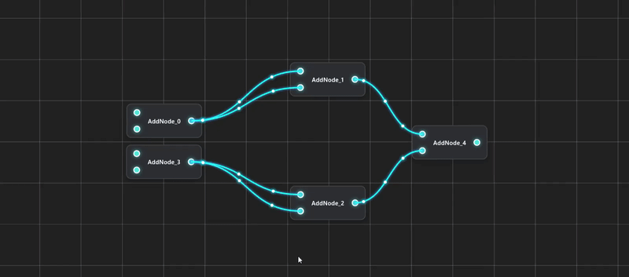
</p>

**GraphFlow** is a powerful, high-performance Flutter package for building interactive node-based editors. By cleanly decoupling the underlying graph data structure from the interactive rendering layer, it provides a highly customizable foundation for building professional visual programming environments, state machine editors, flowcharts, and more.

---

## Core Features

- **Decoupled Architecture:**
  A clean separation between data logic (`GraphModel`) and the interactive UI (`GraphVisualiser`). Easily manipulate the graph programmatically, hook up AI agents, or let users drive via the canvas.

- **High-Performance Rendering:**
  Smooth 60FPS drawing even in dense graphs. Connections feature zero-allocation frame painting and filter-free layered glows to keep your app running fast.

- **Advanced Pan, Zoom & Interactivity:**
  Navigate your canvas easily with native `InteractiveViewer` support. Includes multi-node marquee selection (`Shift` + Drag), automatic Z-ordering for active selections, and live-tracking preview beams for port connections.

- **Smart Connection Validation:**
  Enforces structural integrity out-of-the-box. The library automatically validates port directions (input/output), prevents self-loops, respects maximum connection limits, and strictly checks data types against an allowed connections registry.

- **Rich Visual Customization:**
  Configure grid spacing, colors, and line widths. Choose between Bezier curves or straight lines, and easily toggle animated directional flow dots, line glows, and node highlighting. Includes 9 built-in themes (dark, bright, and futuristic neon).

- **Type-Driven UI Builders:**
  Extend the library by registering custom widget builders mapped to specific node and port types. Build bespoke, highly customized node cards that fit your exact domain.

- **Independent Serialization:**
  Save, share, and load entire scenes. Graph topologies (nodes and connections) and visual canvas layouts (X/Y coordinates) are serialized to and from JSON independently for robust state persistence.

---

## See it in Action

### Connect Nodes via Ports
Drag live-tracking preview beams between ports with automatic type and direction checking.
<p align="center">
  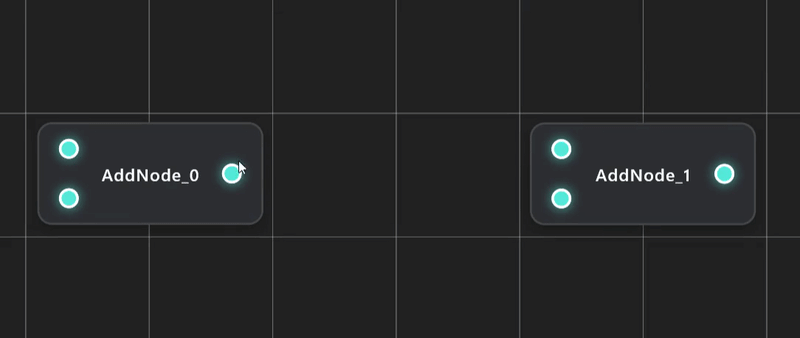
</p>

### Smooth Zoom & Pan
Navigate massive workspaces effortlessly with infinite-feel grid scaling and marquee selection.
<p align="center">
  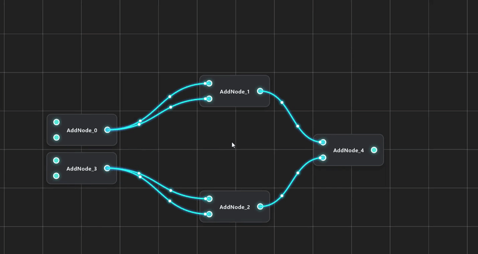
</p>

### Build Complex Networks
Connect nodes with custom routing rules to build full visual pipelines.
<p align="center">
  
</p>

---

## Getting Started

### Installation

Add `graph_flow` to your project's `pubspec.yaml`:

```yaml
dependencies:
  flutter:
    sdk: flutter
  graph_flow: ^1.0.0
```

Then fetch the package:

```bash
flutter pub get
```

---

## Basic Tutorial

### 1. Create the Graph 

Creates the underlying graph object. A graph consists of **Nodes**, **Connections**, and **Ports** (which belong to nodes and govern their interactions).

```dart
GraphModel model = GraphModel(
  allowedConnections: {
    String: [String, dynamic],
    int: [int, double, dynamic],
  },
);
```

**`PortModel`**: Nodes contain ports. Each port has an ID, a data type, a direction (`input`, `output`, or `both`), and an optional limit on the maximum number of connections it can accept.
```dart
PortModel inputA = PortModel(
  id: "id_1_input",
  type: int,
  direction: PortDirection.input,
  maxConnections: 1,
);
```

**`NodeModel`**: Each node contains an ID, a type name, and a list of ports that manage interactions with other nodes.
```dart
NodeModel node = NodeModel(
  id: "id_1",
  typeName: "addNode",
  ports: [inputA],
);
```

**`ConnectionModel`**: Holds the source node and port IDs as well as the target node and port IDs.
```dart
ConnectionModel newConnection = ConnectionModel(
  sourceNodeId: "outputNode",
  sourcePortId: "outputNodePort1",
  targetNodeId: "inputNode",
  targetPortId: "inputNodePort1",
);
```
> **Note:** Connections are typically created using `model.createConnection()`, which first validates whether all conditions for the connection are met. It returns `true` if successful, or `false` otherwise.

### 2. Show your Graph

Visualising a `GraphModel` is straightforward. To manage visual interactions and node positions, create a `GraphVisualiser` and pass it your model:

```dart
GraphVisualiser visualiser = GraphVisualiser(model);
```

To render it inside your application, pass the visualiser to a `GraphCanvas` widget and specify your desired `CanvasLayout` style:

```dart
GraphCanvas(
  visualiser: visualiser,
  canvasLayout: CanvasLayout.darkAnimatedNeonCyan,
)
```

That's it! The graph is now rendered interactively, and the UI will automatically update whenever the underlying `GraphModel` changes.

### 3. Save & Load Support

To save or export a graph's topology, convert the model into standard JSON:
```dart
Map<String, dynamic>? savedGraphData = model.toJson();
```

Additionally, visual attributes (such as node X/Y positions on the canvas) can be saved independently:
```dart
Map<String, dynamic>? savedVisualData = visualiser.toJson();
```

To restore your state, load the JSON maps back into your model and visualiser:
```dart
model.loadFromJson(savedGraphData!, typeRegistry);
visualiser.loadPositions(savedVisualData!);
```

---

## Canvas Layouts

While you have full control over how `NodeVisual` and `PortVisual` widgets look, the canvas grid, connection curves, glows, and flow animations are controlled by `CanvasLayout`.

Out of the box, **GraphFlow** ships with 9 ready-to-use presets:

<table align="center">
  <tr>
    <td align="center">
      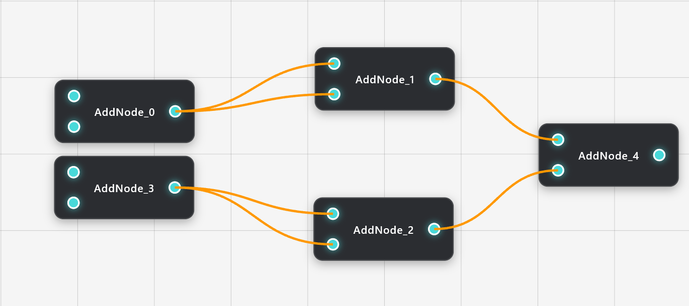<br>
      <code>brightDefault</code>
    </td>
    <td align="center">
      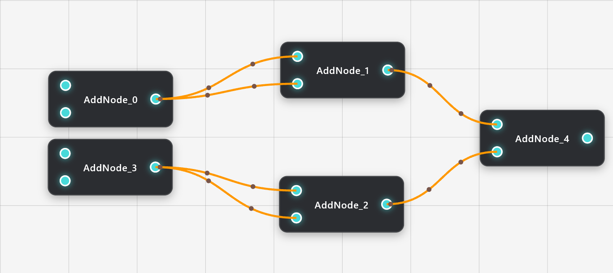<br>
      <code>brightAnimatedDefault</code>
    </td>
    <td align="center">
      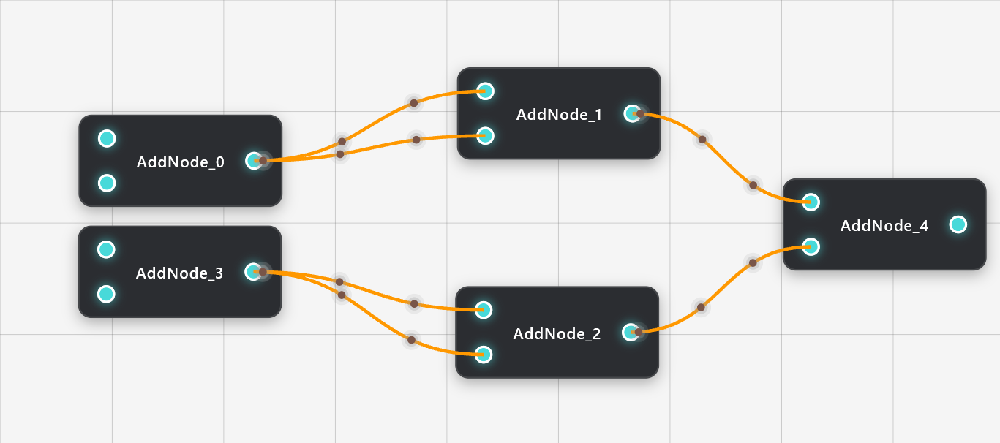<br>
      <code>brightAnimatedGlowDefault</code>
    </td>
  </tr>
  <tr>
    <td align="center">
      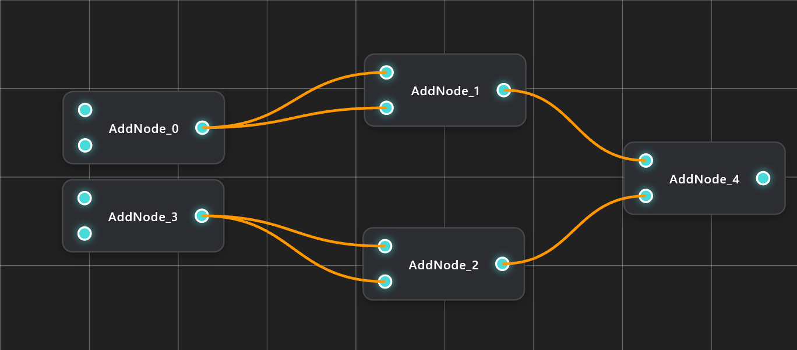<br>
      <code>darkDefault</code>
    </td>
    <td align="center">
      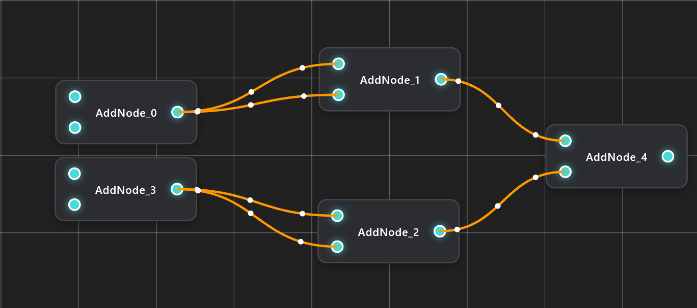<br>
      <code>darkAnimatedDefault</code>
    </td>
    <td align="center">
      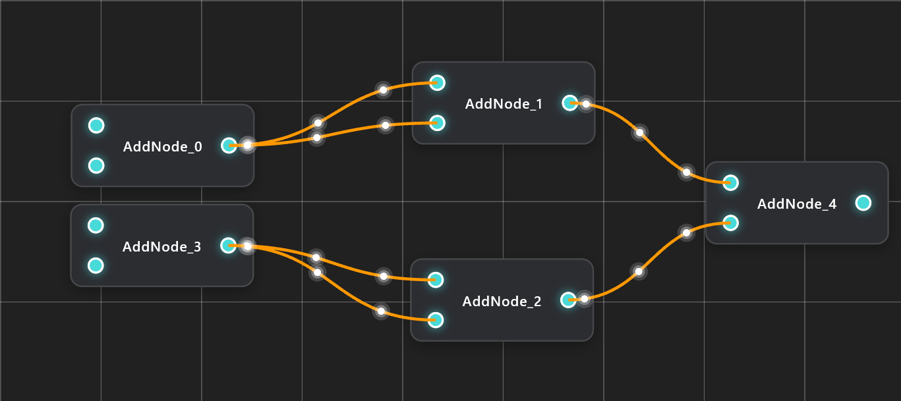<br>
      <code>darkAnimatedGlowDefault</code>
    </td>
  </tr>
  <tr>
    <td align="center">
      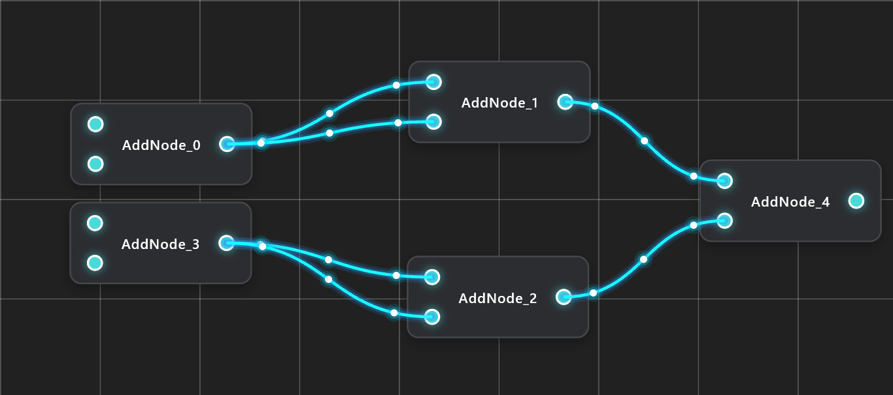<br>
      <code>darkAnimatedNeonCyan</code>
    </td>
    <td align="center">
      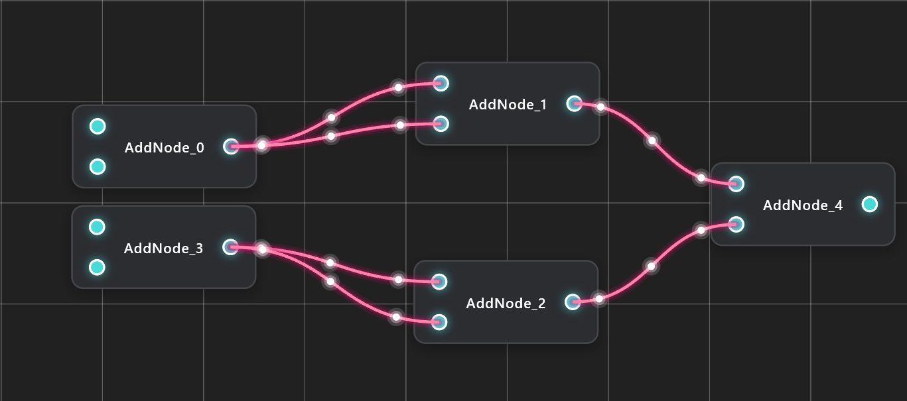<br>
      <code>darkAnimatedNeonPink</code>
    </td>
    <td align="center">
      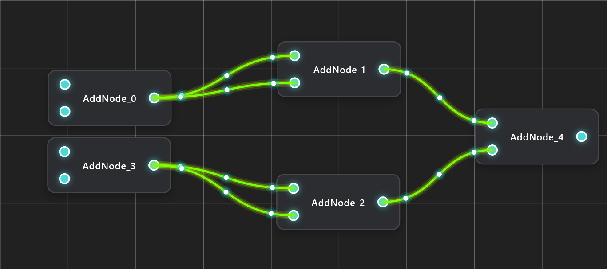<br>
      <code>darkAnimatedNeonYellow</code>
    </td>
  </tr>
</table>

Want to build your own look? Instantiate a custom `CanvasLayout` and tweak everything from grid dimensions to neon shadow colors:
```dart
CanvasLayout(
  canvasWidth: 10000,
  canvasHeight: 10000,
  minScale: 0.1,
  maxScale: 10,
  scaleFactor: 2048,
  gridSpacing: 100,
  gridLineColor: Colors.white,
  gridBackgroundColor: Colors.grey,
  gridLineWidth: 0.2,
  connectionLineColor: Colors.orange,
  connectionLineColorShadow: Colors.pink,
  connectionDotColor: Colors.white,
  connectionDotColorShadow: Colors.pinkAccent,
  highLightColor: Colors.red,
  connectionEnableAnimation: false,
  connectionEnableLineGlow: false,
  connectionEnableDotGlow: false,
  connectionShape: ConnectionShape.bezier,
);
```

---

## Contributing <3

Contributions are very welcome and will be reviewed promptly!

## License

GraphFlow is licensed under the MIT License. See the [LICENSE](https://github.com/NoirsCodingCorner/graph_flow/blob/master/LICENSE) file for details.

## Outlook

GraphFlow is currently fresh in development.
If you have any comments, feedback, or feature wishes for this library, feel free to open an issue on GitHub or leave a note in the Flutter Discord channel.

Thank you all for using my library <3